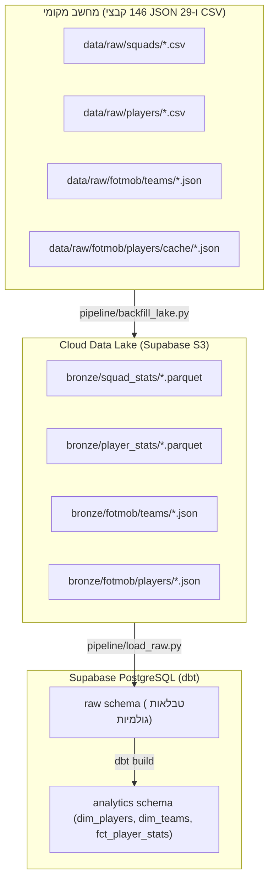

# ⚽ WSL Data Hub · Data Platform Roadmap
> **סטטוס פרויקט:** End-to-End ELT Pipeline הושלם ומאומת במלואו בענן! 🚀  
> **ארכיטקטורה:** Lakehouse (Supabase S3 Data Lake + Postgres Data Warehouse + dbt Core + GitHub Actions Automation).

---

## 📍 מה הושלם בפועל? (Done ✅)

| שלב | רכיב | מה בוצע? | סטטוס |
| :--- | :--- | :--- | :--- |
| **תשתית** | **S3 Data Lake** | הקמת Bucket `wsl-data-lake`, הגדרת S3 Credentials, מודול `wsl_lake` | ✅ מאומת ופעיל |
| **תשתית** | **PostgreSQL DW** | יצירת סכמות `raw` ו-`analytics`, חיבור דרך Pooler (IPv4) | ✅ מחובר ופעיל |
| **שלב 1 (E&L)** | **Ingestion Engine** | `pipeline/ingest.py` עם חוזי Pydantic (`MatchRecord`, `StandingRecord`) | ✅ שואב ושומר ל-Lake |
| **שלב 2 (Raw)** | **Warehouse Loader** | `pipeline/load_raw.py` טוען Parquet מה-Lake לתוך סכמת `raw` ב-DB | ✅ 182 משחקים + 14 קבוצות |
| **שלב 3 (T)** | **dbt Transformations** | מודלי Staging, Dims (`dim_teams`), Facts (`fct_league_standings`) | ✅ 12/12 טסטים עברו |
| **שלב 4 (Serving)**| **Site Exporter** | `pipeline/export_to_site.py` מושך מטבלת ה-Gold ומעדכן את האתר | ✅ מעדכן `_data/` אוטומטית |
| **אוטומציה** | **Master Runner** | `run_pipeline.py` מריץ את כל 4 השלבים ברצף בפקודה אחת | ✅ מוכן להרצה |
| **מיגרציה** | **Lake Backfill** | `pipeline/backfill_lake.py` ממיר 146 קבצי JSON ו-CSV ל-Parquet ב-Lake | ✅ מוכן להרצה |
| **CI/CD** | **GitHub Actions** | `.github/workflows/data_pipeline.yml` תזמון שבועי אוטומטי (Monday 04:00) | ✅ מוכן לפריסה |

---

## 🎯 איך הדאטה הישן מאוחסן ומסודר?

